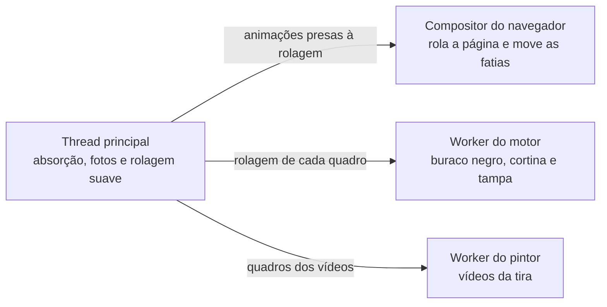

<div align="center">

# Portfólio de Alexsandro Ferreira da Silva

Site pessoal e currículo online, em português e em inglês,<br>
com um buraco negro em WebGL que engole o conteúdo enquanto a página rola.

<br>

[**Ver o site**](https://alexsandrofde.github.io/Portfolio/) &nbsp;·&nbsp;
[English version](https://alexsandrofde.github.io/Portfolio/en/) &nbsp;·&nbsp;
[Currículo em PDF](https://alexsandrofde.github.io/Portfolio/Curriculo-Alexsandro-Ferreira-da-Silva.pdf) &nbsp;·&nbsp;
[LinkedIn](https://www.linkedin.com/in/alexsandro-ferreira-da-silva-6914b6317)

<br>

[](https://github.com/AlexsandroFde/Portfolio/actions/workflows/deploy.yml)


<br><br>

<a href="https://alexsandrofde.github.io/Portfolio/">
  <picture>
    <source media="(prefers-color-scheme: dark)" srcset=".github/readme/topo-escuro.webp">
    
  </picture>
</a>

<br><br>

[Sobre](#sobre) &nbsp;·&nbsp;
[Destaques](#destaques) &nbsp;·&nbsp;
[Tecnologias](#tecnologias) &nbsp;·&nbsp;
[Como rodar](#como-rodar) &nbsp;·&nbsp;
[Conteúdo](#onde-editar-o-conteúdo) &nbsp;·&nbsp;
[O buraco negro](#o-buraco-negro) &nbsp;·&nbsp;
[Desempenho](#desempenho) &nbsp;·&nbsp;
[Deploy](#deploy) &nbsp;·&nbsp;
[Estrutura](#estrutura-do-projeto)

</div>

<br>

## Sobre

Este repositório guarda o código do meu portfólio: o site onde apresento quem sou, os projetos que construí, minha trajetória e as tecnologias com que trabalho, em português e em inglês, com o currículo também em PDF.

O que dá identidade ao site é o fundo. No lugar de uma imagem parada, há um buraco negro desenhado em tempo real com WebGL, com shaders próprios e sem bibliotecas. Conforme a página rola, ele vai engolindo o conteúdo que sobe até ele; depois do rodapé, a rolagem continua e você cai dentro dele, até o topo do site reaparecer do outro lado. Cada parte foi pensada para o efeito correr liso também no celular e para respeitar quem prefere menos movimento.

## Destaques

- **Luz curvada pela gravidade.** O caminho da luz em volta do buraco negro segue a trajetória curva da relatividade geral (Schwarzschild), traçada uma vez em shaders próprios.
- **O conteúdo cai no buraco negro.** Cada bloco que sobe até o alto da tela é puxado para dentro dele e se estica numa tira contínua, a espaguetificação. Rolando para cima, ele volta pelo mesmo caminho.
- **Um mergulho depois do rodapé.** A página não acaba no fim: você cai no buraco negro, e o topo do site chega do outro lado, por uma janela redonda.
- **O cursor tem gravidade.** O mouse é uma pequena massa que curva a malha do fundo em volta dele, com a mesma lente do buraco negro.
- **Fluido mesmo com a página ocupada.** O buraco negro é desenhado num Web Worker, e as fatias da absorção são movidas pelo próprio navegador, junto com a rolagem.
- **Bilíngue de ponta a ponta.** Português e inglês com o mesmo conteúdo, o TypeScript cobrando as duas línguas em cada texto e o HTML de cada versão pré-renderizado no build.
- **Currículo pronto para ATS.** O PDF é gerado a cada build a partir dos mesmos dados do site, numa coluna e com texto selecionável.
- **Cuidado com quem visita.** Com "reduzir movimento" ligado ou num aparelho lento, o buraco negro fica parado no alto da página; com economia de dados, os vídeos ficam no pôster até um toque.

## Tecnologias

| Camada    | Ferramentas                                                                                          |
| --------- | ---------------------------------------------------------------------------------------------------- |
| Interface | React 19 e TypeScript 7                                                                              |
| Build     | Vite 8, com pré-renderização estática de cada página                                                 |
| Estilo    | Tailwind CSS 4, tema claro e escuro, fontes Geist e Geist Mono                                       |
| Gráficos  | WebGL 2 com shaders GLSL próprios, desenhado num Web Worker com `OffscreenCanvas`                    |
| Animação  | Animações presas à rolagem (`ViewTimeline` e `ScrollTimeline`) e View Transitions entre as páginas |
| Currículo | PDF impresso pelo Chrome ou Edge com `puppeteer-core`                                                |
| Qualidade | Oxlint e um script próprio que mede a fluidez das animações                                          |
| Deploy    | GitHub Actions publicando no GitHub Pages                                                            |

O HTML publicado de cada página (português, inglês e a de erro) já contém todo o conteúdo, e o React apenas o hidrata. Isso ajuda no carregamento e na indexação, e o conteúdo continua legível mesmo sem JavaScript.

## Como rodar

Você vai precisar do **Node.js 22.12** ou mais recente. Para gerar o currículo em PDF, o build também usa um **Chrome** ou **Edge** instalado na máquina.

```bash
git clone https://github.com/AlexsandroFde/Portfolio.git
cd Portfolio
npm install
npm run dev
```

O site abre em `http://localhost:5173/Portfolio/`, e a versão em inglês em `http://localhost:5173/Portfolio/en/`.

| Comando                    | O que faz                                                                |
| -------------------------- | ------------------------------------------------------------------------ |
| `npm run dev`              | Sobe o servidor de desenvolvimento                                       |
| `npm run build`            | Gera o site e o currículo em PDF em `dist/`                              |
| `npm run preview`          | Serve o build em `http://localhost:4173/Portfolio/`                      |
| `npm run lint`             | Roda a análise estática (Oxlint)                                         |
| `npm run medir`            | Mede a fluidez das animações no build ([como funciona](#medindo-a-fluidez)) |
| `npm run images -- <foto>` | Gera as versões otimizadas da foto de perfil                             |

## Onde editar o conteúdo

Todo o conteúdo fica em arquivos de dados, separados dos componentes. Para atualizar o site, quase sempre basta mexer em `src/data/`.

| Conteúdo                                                           | Arquivo                        |
| ------------------------------------------------------------------ | ------------------------------ |
| Nome, contatos (e-mail, WhatsApp, GitHub, LinkedIn) e apresentação | `src/data/profile.ts`          |
| Currículo em PDF                                                   | `src/data/curriculo.ts`        |
| Projetos (e quais aparecem como destaque)                          | `src/data/projects.ts`         |
| Vídeos dos projetos                                                | `src/assets/projects/`         |
| Formação, experiências e atividades                                | `src/data/journey.ts`          |
| Habilidades e cursos                                               | `src/data/skills.ts`           |
| Textos fixos da interface (menu, botões etc.)                      | `src/i18n/interface.ts`        |
| Página de erro 404                                                 | `src/components/NotFound.tsx`  |
| Cores, fontes e animações                                          | `src/index.css`                |
| Buraco negro do fundo da página                                    | `src/lib/buracoNegro/`         |
| Título, descrição e prévia de compartilhamento                     | `index.html` e `en/index.html` |

### Projetos

- Os projetos com `featured` aparecem como cartões em **Destaques**, na ordem desse número. Os demais vão para a lista **Outros projetos**, que tem filtros por área.
- Cada projeto tem um `summary`, uma frase usada na lista, e uma `description`, o texto completo dos cartões.
- Um projeto sem o campo `repo` aparece como repositório privado, com cadeado e sem link.

### Vídeos dos projetos

Um projeto pode ter um vídeo curto (campo `video`): um MP4 sem som, em 16:9, que toca em loop como um GIF. Para não pesar, ele só é baixado quando aparece na tela, pausa ao sair dela e tem botão de pausar.

O vídeo também não toca sozinho para quem ativou "reduzir movimento" no sistema, nem para quem pede economia de dados ao navegador (o modo econômico dele ou do sistema). Nesses casos ele fica no pôster até um toque no botão, e percorrer os projetos deixa de baixar os uns 4 MB dos vídeos.

> [!TIP]
> Para manter o site leve, exporte os vídeos em 1280x720, 30 fps e uns 15 segundos (H.264, CRF entre 26 e 28), junto com um quadro em WebP para o pôster.

### Português e inglês

O site tem duas versões com o mesmo conteúdo: a principal, em português, e a em inglês, em `/en/`. Nos arquivos de dados, cada texto é um par com as duas línguas:

```ts
summary: {
  pt: 'Personalização de canecas com prévia em tempo real',
  en: 'Mug customization with a real-time preview',
},
```

Nomes próprios e tecnologias, que são iguais nos dois idiomas, podem ser um texto só (`name: 'Beka'`), e o TypeScript avisa se faltar uma das línguas. O título, a descrição e a prévia de compartilhamento de cada versão ficam em `index.html` e `en/index.html`.

No cabeçalho, o link **EN**/**PT** leva para a mesma seção na outra versão. A troca entre as versões (e a volta da página de erro para o início) usa a transição de página do navegador: a página de antes some enquanto a nova aparece, em 0,25 s, em vez de um corte seco para uma página ainda vazia. Com o movimento reduzido, a troca é direta.

> [!NOTE]
> O pedido da transição fica num `<style>` dentro de cada HTML (`index.html`, `en/index.html` e `404.html`), e não no CSS. Com ele só no arquivo CSS, o Chrome pulava a transição sempre que o CSS ou o JavaScript da página nova demorava um pouco a chegar (com 100 ms de atraso, em todas as trocas medidas). As animações dela ficam no `index.css`, separadas das da troca de tema pelo tipo da transição.

### Currículo em PDF

O site tem links para o currículo no topo da página e em **Contato**. São dois arquivos, um por idioma, gerados a cada build a partir de `src/data/curriculo.ts`:

- `Curriculo-Alexsandro-Ferreira-da-Silva.pdf`, em português;
- `Resume-Alexsandro-Ferreira-da-Silva.pdf`, em inglês.

Nome, e-mail e links vêm de `profile.ts`, e os cursos e as competências comportamentais vêm de `skills.ts`. O visual fica em `src/curriculo/`.

O formato foi pensado para os sistemas de triagem de RH (ATS): uma coluna, texto selecionável, seções com nomes usuais e datas no formato MM/AAAA. Para conferir o que esses sistemas leem, extraia o texto do PDF (com `pdftotext`, por exemplo).

> [!NOTE]
> O PDF é impresso por um Chrome ou Edge instalado na máquina, que o build encontra sozinho. Se ele não encontrar, defina `CHROME_PATH` com o caminho do navegador. No deploy, o GitHub Actions usa o Chrome que já vem no runner. O PDF não existe no `npm run dev`: para vê-lo localmente, use `npm run build` e `npm run preview`.

### Foto de perfil

O site usa versões otimizadas da foto (`src/assets/profile-*.webp`), geradas a partir do arquivo original em `assets/`. Para trocar a foto:

```bash
npm run images -- assets/nova-foto.png
```

Depois, faça o commit dos arquivos gerados em `src/assets/`. As imagens de prévia usadas ao compartilhar o link (`public/og.jpg` e, em inglês, `public/og-en.jpg`) são arquivos à parte.

### Página de erro

O GitHub Pages mostra o `404.html` para qualquer endereço que não existe no site. A página segue o visual do site, fica em português com o essencial também em inglês e leva de volta ao início ou à versão em inglês.

## O buraco negro

O fundo do site é um buraco negro desenhado em WebGL 2, com shaders próprios e sem bibliotecas. Ele acompanha a visita inteira:

1. **No topo**, fica no canto de cima à direita, logo abaixo do cabeçalho, com cerca de um terço à vista, como algo muito distante (a malha fica numa camada intermediária).
2. **Ao longo da página**, anda pelo alto da tela, cresce e engole o conteúdo que sobe até ele.
3. **Depois do rodapé**, a rolagem continua, e você cai dentro dele.
4. **Do outro lado**, o topo do site chega por uma janela redonda, e a página recomeça.

Quase tudo responde só à posição da rolagem. Rolando devagar ou rápido, com a roda do mouse, o botão do meio, o toque ou o teclado, cada posição da página mostra sempre a mesma imagem, como um filme que a rolagem avança e volta.

O código fica em [`src/lib/buracoNegro/`](src/lib/buracoNegro/), e os arquivos citados nesta seção sem o caminho completo estão nessa pasta.

### A luz e o disco

O caminho da luz em volta do buraco negro é traçado uma vez só, antes de ele aparecer. Para cada ponto da imagem, o shader `geodesicas.frag` segue o raio de luz de trás para a frente, na trajetória curva em volta do buraco negro, e guarda num mapa onde ele cruzou o disco de gás e quanto de névoa atravessou.

Desse mapa saem a sombra, o anel de luz e o disco, visto quase de lado, como em *Interstellar*: uma faixa fina passa na frente da sombra, enquanto a luz da parte de trás do disco, dobrada pela gravidade, contorna a sombra por cima e por baixo, em arcos. A parte de baixo do disco só aparece por baixo da de cima: o arco que contorna a sombra por baixo não continua subindo rente a ela, acima da faixa da frente.

A malha quadriculada da apresentação também é desenhada junto com ele (`composicao.frag`), curvada pela gravidade. No tema escuro, o disco brilha na cor de destaque; no claro, vira uma gravura em nanquim.

O gás gira com a velocidade de cada órbita, mais rápido perto do centro, sem que o desenho se enrole com o tempo: cada anel da textura gira inteiro e desliza sobre os vizinhos, e a rotação fecha um ciclo exato a cada três horas, mais ou menos. Girar não exige traçar raio nenhum: a cada quadro, `disco.frag` só põe o gás, na posição em que a rotação o deixou, sobre os pontos do disco que o mapa guarda, com o brilho de cada um (o efeito Doppler e o desvio gravitacional também vêm prontos do mapa).

O disco ainda reage ao sentido da rolagem, e não à velocidade: enquanto a página desce, ele esquenta e gira um pouco mais rápido; enquanto sobe, saem os jatos. Ele acompanha com um pequeno atraso, sem pulsar a cada tranco da roda.

### O cursor também tem gravidade

O mouse é uma pequena massa que curva a malha em volta dele, com a mesma lente do buraco negro, e a revela num círculo em qualquer ponto da página. No meio, a lente é amaciada e não tem sombra: a malha ali só aparece ampliada, e as linhas se curvam em volta dele.

A massa segue o ponteiro com um pouco de inércia (o que também esconde o atraso de o ponteiro chegar da thread principal), fica mais forte enquanto ele se mexe e mais fraca com ele parado, e some quando o mouse sai da janela e no começo do mergulho. No tema escuro, as linhas perto dela puxam para a cor de destaque, com um brilho fraco em volta; no claro, ficam no traço de nanquim.

Quem a desenha é o motor, no mesmo quadro do buraco negro: a página só manda a posição do ponteiro, e o cursor do sistema continua o de sempre. Só o mouse tem massa (um toque não), e com o movimento reduzido ela não aparece.

### A absorção

<picture>
  <source media="(prefers-color-scheme: dark)" srcset=".github/readme/absorcao-escuro.webp">
  
</picture>

<br><br>

Ao longo da página, no mesmo ritmo da rolagem, o buraco negro anda pelo alto da tela até chegar ao meio dela no fim do conteúdo e cresce, cada vez mais perto, até três vezes o tamanho. O ponto mais baixo dele fica parado na mesma altura, e o resto cresce para cima e para os lados.

Só o conteúdo que sobe até uma faixa estreita logo abaixo do cabeçalho é absorvido. Cada linha que entra na faixa é puxada até o buraco negro, devagar no começo e cada vez mais rápido, ficando mais estreita e esmaecendo na mesma medida (inteira na borda da faixa, quase invisível perto do centro), até sumir de vez ao cruzar a borda da sombra: nada aparece dentro dela. As linhas de cima vão na frente e as de baixo ainda estão presas à página, então o conteúdo se alonga numa tira contínua que sai da página e entra no buraco negro, a *espaguetificação*.

- **Blocos altos são engolidos aos poucos.** Num cartão de projeto, só o trecho que já está na faixa é puxado; o resto continua no lugar até chegar a sua vez.
- **A tira não se parte.** Cada bloco mira o ponto em que o buraco negro está quando o meio do bloco cruza a faixa. Todas as fatias dele vão ao mesmo ponto e, como o buraco negro anda devagar, a tira chega lá já dentro da sombra.
- **A rolagem é o relógio.** Quanto cada bloco já foi absorvido depende só de onde ele está na tela, e o desenho de cada posição da rolagem é calculado de antemão. Com a página parada, o que estava no meio do caminho continua ali; rolando para cima, o conteúdo é cuspido de volta pelo mesmo caminho. Tudo muda de forma contínua com a rolagem.

Os blocos absorvidos são os que já têm animação de entrada (`Reveal` e `.enter`), e a lógica fica em `src/lib/buracoNegro/absorcao.ts`.

Como o alto da tela passa a ser do buraco negro, os links do menu levam cada seção para logo abaixo da faixa de absorção, e não para o topo: o JavaScript calcula essa altura e a passa ao `scroll-padding-top` do `index.css` (a variável `--topo-livre`). Sem o efeito, vale a distância padrão.

<details>
<summary><strong>Como a absorção é desenhada</strong></summary>

<br>

**Fatias.** Uma transformação CSS deforma um elemento inteiro de um jeito só. Por isso, o trecho de cada bloco que está na faixa é desenhado em fatias de uns 10 px (sempre um número inteiro de pixels da tela), cada uma deformada no seu trapézio. As bordas de fatias vizinhas coincidem, e a tira sai contínua.

**Fotos.** A absorção é toda pré-renderizada: cada bloco tem uma foto, feita uma vez, longe da faixa, e cada fatia é só um retângulo com o seu pedaço dela de fundo, sem nada dentro. A foto (`fotos.ts`) sai de um SVG com um clone do bloco num `foreignObject`, com as regras de estilo da página (as fontes e as imagens embutidas, porque um SVG usado como imagem não busca nada fora dele, e as media queries e as unidades da janela resolvidas pela própria página) e com o zoom da tela, para as bordas e o texto caírem nos mesmos pixels que os do original. O navegador desenha esse SVG numa tela, na resolução da tela e na mesma fração de pixel em que o bloco está na página, e a tela vira um PNG, decodificado uma vez e usado por todas as fatias do bloco. Numa janela de verdade, a foto bate praticamente pixel a pixel com o original.

**Cortina.** As fatias ficam numa camada fixa no alto da tela, sem foco, clique ou leitor de tela, por cima de uma cortina: um canvas que cobre a faixa com o fundo da página, o buraco negro e a malha (copiados do canvas do fundo a cada desenho). O bloco original não sai do lugar nem muda, e nada nele depende da rolagem: ele só passa por trás da cortina, que o corta exatamente na beira da faixa.

**Animações presas à rolagem.** Quem move as fatias é o navegador, e não o JavaScript. Cada fatia tem uma animação presa à rolagem (uma `ViewTimeline` ancorada no `main`, em `rolagem.ts`), com um quadro-chave para cada pixel da tela que a página rola enquanto a fatia atravessa a faixa. Cada quadro vale até o próximo, sem interpolação: entre duas perspectivas, o navegador interpola mal, e o trapézio saía torto. A rolagem corre fora do JavaScript, que chega a ficar um quadro ou mais para trás dela; as animações correm junto com ela, na mesma etapa, e a tira não se descola do original na beira da cortina, por mais rápida que seja a rolagem.

**Tampa.** O esmaecimento e o sumiço na sombra ficam por conta de uma tampa: um segundo canvas, por cima das fatias, com a mesma imagem da cortina, tanto mais opaca quanto mais o conteúdo já foi puxado naquela altura (a altura de cada linha na faixa diz o quanto ela já foi puxada) e inteira na sombra do buraco negro. Sobre a cortina, isso dá exatamente o que daria uma máscara nas fatias, sem o custo dela: com a máscara, o navegador desenhava todas as fatias à parte, a cada quadro, e só então as recortava. Quem desenha a tampa é o motor do buraco negro, no mesmo quadro da cortina, com a sombra onde ele a desenhou. As contas da faixa ficam em `faixa.ts`, para a página e o motor fazerem as mesmas.

**Fatias de prontidão.** As fatias esperam a vez logo acima da tela, fora dela, já desenhadas: dentro da tela, mesmo recortadas, cada fatia nova precisava estar desenhada antes de o quadro seguinte da página aparecer. No topo da página elas também ficam lá, e a absorção aparece no segundo pixel de rolagem, junto com a cortina e a tampa.

**Linhas e títulos.** As linhas soltas da página (a borda de cima das seções e das listas) também são absorvidas, como blocos de uma fatia só desenhados por um modelo da linha. Os títulos fixos das seções, que param dentro da faixa, ficam por cima da cortina e da tampa.

**Por que `ViewTimeline`.** Uma `ScrollTimeline` vai do topo à rolagem máxima, e a rolagem máxima muda com a página rolando (no celular, quando a barra do navegador some ou volta; e quando a página muda de altura). A cada mudança, o Chrome reenviava todas as animações ao compositor, com as centenas de quadros-chave de cada uma (no celular emulado, um quadro de uns 30 ms por mudança). A `ViewTimeline` ancorada no `main` acompanha a posição dele na tela e não depende da rolagem máxima. Os trechos são contados do topo dele, sem o recuo do `scroll-padding-top`, que ela descontaria por padrão. O mergulho, que fica depois do `main`, continua com a `ScrollTimeline`.

</details>

<details>
<summary><strong>O que fica com o JavaScript</strong></summary>

<br>

Ao JavaScript resta pôr as fatias no lugar antes de a página chegar a elas e refazer a foto quando o original muda sem rolagem, para nada se partir entre ele e a tira.

**Agenda das fotos.** As fotos são feitas com o tempo que sobra entre os quadros, das mais perto da faixa às mais longe, e uma foto velha continua valendo até a nova ficar pronta. A de um bloco que chega perto da faixa sem foto nenhuma não espera a página ficar ociosa: começa logo depois do quadro, e não dentro dele. Lá, medir o bloco depois de mexer nas fatias obrigava o navegador a refazer o layout na hora (rolando logo que a página abre, com a CPU 4 vezes mais lenta, o tempo em layouts forçados caiu quase pela metade).

**Vídeos.** Cada fatia que cruza um vídeo tem uma tela, por cima da foto, com a parte do quadro atual que cai nela (com os cantos arredondados do cartão). Quem desenha nessas telas é outro worker, o pintor (`pintor.ts`, ligado à página por `telas.ts`), que recebe cada quadro novo dos vídeos assim que ele existe. O que ele desenha vai para a tela sem esperar a thread principal e, rolando rápido, com a página para trás, os vídeos da tira continuam com todos os quadros. As telas passam de fatia em fatia, guardadas numa reserva (um canvas entregue a um worker não volta), e só as das fatias que estão na faixa recebem cada quadro. O que fica na frente do vídeo, como o botão de pausa, tem uma foto à parte, que o pintor desenha por cima de cada quadro. Sem worker, `OffscreenCanvas` ou `VideoFrame`, as fatias mostram o pôster do vídeo.

**Animações dentro dos blocos.** O que se anima sem parar dentro de um bloco (o ponto que pulsa ao lado do status) fica fora da foto, e a fatia que passa pelo meio dele leva uma cópia viva dele, no mesmo passo da animação do original.

**Mouse, tema e React.** O mouse em cima de um bloco, a troca de tema e o que o React redesenha dentro dele (o ícone de um vídeo que pausou, por exemplo) pedem foto nova, só a da frente do vídeo se a mudança foi só ali. Numa imagem não há mouse: os elementos com o mouse em cima são marcados no clone, e as regras de `:hover` passam a valer para a marca. Cada bloco guarda as fotos dos estados do mouse que já teve (até quatro): o mouse que sai de um bloco, ou volta a um estado já visto, troca a foto na hora, mesmo rolando.

**Quando refazer.** Refazer uma foto custa alguns milissegundos numa tarefa só (o navegador monta um documento para o SVG). Por isso, a foto nova espera as transições do original acabarem e, longe da faixa, a página parar de rolar; a de um bloco que está na faixa, à vista, não espera a rolagem.

**Foco do teclado.** Um bloco com o foco do teclado passa para a frente da cortina e da tampa e fica inteiro no lugar até o foco sair dele. O mesmo acontece, por um instante, com um bloco que chega à faixa antes de a foto dele ficar pronta.

</details>

### A rolagem suave

Enquanto a absorção age, a roda do mouse e o dedo passam por uma rolagem suave (`rolagemSuave.ts`), que limita a aceleração e a velocidade da página:

- **Roda do mouse.** A roda não move a página na hora: muda o destino dela, e a página anda até lá com a aceleração limitada (6 telas por segundo, a cada segundo) e sem passar de 3 telas por segundo, arrancando e freando aos poucos, por mais forte que seja o giro.
- **Dedo.** O dedo arrasta a página com ele, sem passar da mesma velocidade, e o embalo que ele deixa ao sair da tela perde velocidade aos poucos, também com a aceleração limitada.
- **Links da página.** Os links para outro ponto da página (o menu, o logo, os botões da apresentação), clicados com o mouse ou o dedo, também vão pela rolagem suave, com a mesma aceleração e até 8 telas por segundo. Com a velocidade da roda, voltar ao topo do fim da página levava uns 4 s; assim, leva uns 3 s. Eles param onde o navegador pararia, logo abaixo da faixa; o endereço muda como com o link, e o voltar do navegador funciona.
- **Teclado e busca.** O teclado (inclusive o Enter num link, que também leva para lá o ponto de partida do Tab) e a busca do navegador continuam com a rolagem do navegador, e a rolagem suave segue de onde eles deixam a página.

Quem move a página é o próprio laço de quadros da absorção, antes de preparar as fatias. Assim, a página nunca anda à frente do que a absorção vê, como acontecia com a rolagem do navegador, que corre fora do JavaScript e, rápida demais para um celular, levava o conteúdo à faixa antes de as fatias dele estarem prontas. Num quadro lento, a página anda menos, em vez de saltar.

> [!NOTE]
> Ligada, a rolagem suave tira do navegador a rolagem pelo dedo (`touch-action: pinch-zoom` no `html`; a pinça do zoom continua). No celular, a barra de endereço não some ao rolar e o puxar para recarregar não funciona. Quem prefere menos movimento, ou tem um aparelho lento demais para o efeito, fica com a rolagem do navegador.

### Tudo pronto de antemão

Tudo o que o buraco negro mostra é calculado de antemão, e a animação só lê o que já está pronto:

- **O mapa dos raios**, traçado em oito faixas, uma por quadro, antes de o buraco negro aparecer. Um mapa só serve a todos os tamanhos dele, do canto ao mergulho.
- **O trajeto** pela página e pelo mergulho: a posição, o tamanho e o ângulo da câmera para cada pixel de rolagem, tabelados em `trajeto.ts`.
- **A rotação do disco**, que é o gás deslizando sobre o mapa.

Quem desenha é um worker (`trabalhador.ts`, que roda `motor.ts`), com o canvas do fundo, a cortina, a tampa e a tela de cima transferidos para ele (`ponte.ts`). O laço de quadros dele corre fora da thread principal, e nada do que pesa nela (a absorção, os vídeos, o React) atrasa um quadro do buraco negro, que gira e anda no ritmo da tela, como a rolagem.



A página só manda para o motor a rolagem de cada quadro seu, que, com a página pesada, pode chegar na metade do ritmo da tela. O motor desenha a rolagem de um instante antes, entre duas notícias que já tem, suavizada, e o buraco negro e a malha andam lisos, sem passar do ponto quando a rolagem para. Onde não há worker com `OffscreenCanvas`, o mesmo motor roda na thread principal.

### O mergulho

<picture>
  <source media="(prefers-color-scheme: dark)" srcset=".github/readme/mergulho-escuro.webp">
  
</picture>

<br><br>

A página não acaba no rodapé: a rolagem continua por um espaço vazio (`src/components/Dive.tsx`), num laço sem fim. Na primeira tela dele, a página sai toda de vista; depois, no trecho do mergulho, você cai no buraco negro. Ele, que chegou ao meio do alto da tela já grande, desce até o meio dela e continua crescendo, cada vez mais rápido, inteiro à vista (os arcos de luz por cima e por baixo da sombra), até a sombra preencher a tela inteira. A malha cresce junto, em volta dele.

A vista é a de quem cai (`queda.frag`):

- o espaço em volta da sombra se torce num redemoinho, no sentido em que o disco gira, e a faixa do disco se enrosca nela;
- as coisas correm para fora a partir do meio da tela, em rastros que se alongam quanto mais depressa se cai e quanto mais rápida a rolagem;
- grãos de poeira passam por quem cai, em perspectiva, cada vez mais depressa;
- a luz se separa em cores nas bordas, como numa lente forte;
- a visão se fecha num túnel, escurecendo as bordas, e no tema escuro a luz de fora fica mais azul e mais forte;
- perto do horizonte, a vista treme;
- o cabeçalho é puxado para dentro e some.

A cena é desenhada numa textura um pouco maior que a tela, e a queda só a lê em outros pontos: nenhum raio é traçado, e o mergulho custa no motor o mesmo que o resto da página. Perto do fim, a tela passa a mirar acima do centro da sombra, para a faixa do disco que a cruza sair por baixo e sobrar só o preto, e um véu preto preso à rolagem apaga o que sobra, cabeçalho incluído.

### A volta ao topo

Aí estamos dentro dele. A página volta ao topo e, no escuro, acende-se um ponto de luz no meio da tela. Ele se abre numa janela redonda, com a borda brilhando como o anel em volta da sombra, e por ela vem o topo do site, minúsculo, lá do fundo, ainda na vista de quem cai: a mesma da queda (`queda.frag`), só que sem o redemoinho e sem o tremor, e nada gira.

- Grãos de poeira passam correndo para fora, em perspectiva, enquanto o site ainda está longe.
- Tudo deixa rastros para fora, mais longos quanto mais depressa o site se aproxima.
- A luz do site fica mais azul no tema escuro.
- A visão, fechada num túnel no começo, se abre conforme ele chega.

O site vem arredondado, como pintado numa bola vista de frente: o meio dele ampliado e as beiras apertadas contra a borda da janela, com o buraco negro do canto curvado junto. Ao chegar, a bola se achata, os rastros somem e a janela passa dos cantos da tela.

O véu da página segura o preto até o motor avisar que a entrada já está na tela. Durante a entrada, a rolagem fica travada, para o embalo da roda ou do dedo não levar o topo embora, e de lá não há para onde subir. Como a absorção, o mergulho depende só da posição da rolagem, e rolando para cima ele volta atrás; só a entrada anda no tempo.

A lógica fica em `mergulho.ts` (o véu, a janela sem o motor, o cabeçalho e a volta ao topo), na função `posicaoEm` de `trajeto.ts` (o buraco negro) e em `entrada.ts` (a curva da entrada).

<details>
<summary><strong>Como a volta ao topo é desenhada</strong></summary>

<br>

**A foto do topo.** Quem desenha o site chegando é o motor, a partir de uma foto do topo do site (`fotografarTopo`, em `fotos.ts`): a tela como ela fica com a página no topo, com o cabeçalho e o que o conteúdo mostra ali. Ela é feita como as fotos da absorção, num SVG com os clones desenhado na resolução da tela, e entregue ao worker como uma imagem, sem cópia, onde vira uma textura com mipmaps (lida pequena lá no fundo sem virar chuvisco). O cabeçalho, que muda com a rolagem, sai na foto como ele é no topo, sem o fundo desfocado e sem a seção ativa no menu. A foto é feita com a página ociosa, logo que o efeito começa, e de novo quando o tema, o tamanho da tela ou as fontes mudam.

**Duas passadas.** `entrada.frag` faz a imagem (o site na bola, sobre a cena, a janela e o escuro em volta) numa textura, e a vista de quem cai a leva à tela.

**A tela de cima.** Durante a entrada, uma tela do motor cobre a página toda, cabeçalho incluído, com o mesmo quadro do canvas. A página fica parada no topo, por baixo dela, já desenhada, e o navegador não anima nada. O último quadro da entrada é a página como ela é, pixel por pixel, e a tela de cima esmaece em 0,16 s, deixando a página de verdade no lugar. Trocadas de uma vez, as letras piscariam: o texto da página é suavizado em cores, e o da foto, em cinza.

**Para não pesar.** Longe da janela, que passa a maior parte da entrada pequena, a cena e a foto nem são lidas; a primeira passada só cobre a tela; e, nos rastros da entrada, as cores não se separam como na queda (cada ponto do rastro é uma leitura da imagem, e não três; a borda da janela já tem as cores separadas).

**Sem a foto.** Quando a foto ainda não foi feita, ou onde o navegador não deixa ler a imagem do SVG (no Safari), o navegador traz o site, aumentando o cabeçalho e o conteúdo a partir do meio da tela, recortados à primeira tela, e o motor desenha a janela e o escuro atrás deles, os dois a partir do mesmo instante e pela mesma curva (`entrada.ts`). Nesse caso, o site só cresce, sem girar nem aparecer aos poucos: girado, o recorte à primeira tela deixava de ser um retângulo alinhado à tela, e uma opacidade animada no conteúdo inteiro também pesava (o navegador travava uns dois décimos de segundo na primeira entrada).

</details>

### Movimento reduzido, aparelhos lentos e alternativas

- **Movimento reduzido.** Quem ativou "reduzir movimento" no sistema vê o buraco negro parado no alto da página, sem absorção e sem a massa do mouse, e fica com a rolagem do navegador. No fim da página, o topo volta só com um fade, e a troca entre as versões do site é direta.
- **Aparelho lento.** A resolução cai sozinha em aparelhos que não dão conta do desenho, julgado pelo próprio motor, fora da thread principal. Num aparelho lento demais para o desenho ou para a absorção, o buraco negro também fica parado no alto da página, sem absorção.
- **Como o aparelho é julgado.** Conta o quadro típico de cada segundo (a mediana), e não a média: engasgos isolados, como os de um ou dois segundos que o Windows às vezes tem ao reorganizar a composição da tela quando um vídeo começa a tocar, não desligam o efeito. Na thread principal, o limite é de 12 quadros por segundo: as fatias são presas à rolagem com pelo menos três décimos de segundo de antecedência, e um quadro a cada 80 ms ainda as põe no lugar a tempo (com o limite em 25, o efeito parava ao rolar um pouco mais rápido pelos projetos, nos segundos em que a placa de vídeo fica ocupada).
- **Sem WebGL.** Sem WebGL 2, fica a malha em CSS de antes. Sem WebGL ou num aparelho lento, o buraco negro não mergulha, mas o véu escurece a tela do mesmo jeito e a janela se abre num furo dele, sem o túnel.
- **Sem worker com `OffscreenCanvas`.** O mesmo motor roda na thread principal.
- **Sem `ScrollTimeline`.** O JavaScript leva as animações das fatias à rolagem a cada quadro: o desenho é o mesmo, mas, rolando rápido, ele pode chegar um quadro atrasado.
- **Sem JavaScript.** O conteúdo continua todo no HTML pré-renderizado, e o espaço do mergulho não existe.

### Parâmetros para ajustar

Os valores do efeito ficam em constantes com nomes em português, nos arquivos de `src/lib/buracoNegro/`. Só o tamanho do espaço do mergulho fica no `index.css`.

<details>
<summary><strong>Ver todos os parâmetros</strong></summary>

<br>

| Arquivo           | Parâmetro                               | O que controla                                                                      |
| ----------------- | --------------------------------------- | ----------------------------------------------------------------------------------- |
| `trajeto.ts`      | `CANTO`                                 | Quanto do buraco negro fica à vista no topo                                         |
|                   | `INCLINACAO`                            | O ângulo de onde ele é visto                                                        |
|                   | `ZOOM_PAGINA`                           | Quanto ele cresce ao longo da página                                                |
|                   | `BASE`                                  | O ponto mais baixo dele, que fica parado enquanto ele cresce                        |
|                   | `MERGULHO`                              | O mergulho                                                                          |
| `index.ts`        | `faixa`                                 | A altura da faixa de absorção                                                       |
|                   | `ANTECEDENCIA` e `FOLGA`                | Quanto da página fica preparado de antemão                                          |
|                   | `AQUECER`                               | Até onde as fotos são refeitas primeiro                                             |
|                   | `MAPA`                                  | A resolução do mapa dos raios                                                       |
|                   | `SUMIR`                                 | Em quanto tempo a tela de cima esmaece no fim da volta ao topo                      |
|                   | `ESPERA_DA_FOTO`                        | Quanto a foto do topo espera depois de o site mudar                                 |
| `absorcao.ts`     | `FATIA`                                 | A altura das fatias                                                                 |
|                   | `ESPERA_DO_MOUSE` e `ESPERA_DA_ROLAGEM` | Quanto uma foto velha espera o mouse e a rolagem                                    |
|                   | `VARIANTES`                             | Quantas fotos de estados do mouse cada bloco guarda                                 |
| `rolagemSuave.ts` | `ACELERACAO` e `VELOCIDADE`             | A aceleração e a velocidade máximas da rolagem suave                                |
|                   | `FREIO`                                 | Quanto da aceleração ela usa para frear                                             |
|                   | `CHEGADA`                               | Em quanto tempo a página alcança o destino da roda e do embalo do dedo              |
|                   | `VELOCIDADE_DO_LINK`                    | A velocidade máxima indo a um link                                                  |
| `faixa.ts`        | `esmaecimento`                          | O esmaecimento ao longo da faixa                                                    |
|                   | `HORIZONTE`                             | A borda da sombra                                                                   |
| `mergulho.ts`     | `VEU`                                   | Quando o véu escurece a tela                                                        |
|                   | `CABECALHO`                             | Quando o cabeçalho é puxado                                                         |
| `motor.ts`        | `RASTRO`                                | A força dos rastros da queda                                                        |
|                   | `vistaNaQueda`                          | A força de cada parte da vista de quem cai, na queda                                |
|                   | `MASSA`                                 | A inércia da massa do mouse, quanto ela leva para aparecer e sumir, e a agitação    |
| `cena.glsl`       | `CURSOR_*`                              | A lente e o círculo da massa do mouse                                               |
| `entrada.ts`      | `ENTRADA`                               | A duração da entrada, de que tamanho o site aparece lá dentro e a margem da janela |
|                   | `vistaDaEntrada`                        | O quanto o site vem arredondado e a vista de quem cai na entrada                    |
| `src/index.css`   | `.mergulho`                             | O tamanho do espaço depois do rodapé                                                |

</details>

## Desempenho

### O que mantém o efeito leve

- O código do efeito só é baixado depois que a página carrega, e a animação pausa com a aba escondida.
- As fatias ficam prontas antes da hora: rolando, cada quadro gasta no máximo meio milissegundo com as que ainda não vão aparecer.
- Cada fatia é só um retângulo com um pedaço de uma imagem já decodificada, então quase não custa para criar nem para desenhar. As que a rolagem deixou para trás saem da página (paradas ali, escondidas, pesavam em todo quadro em que o navegador repinta algo).
- As fatias de cada bloco ficam num grupo só delas na camada, com a foto numa variável CSS do grupo: trocar a foto é mudar uma propriedade só. As que atravessam a faixa com o puxão inteiro dividem os mesmos quadros-chave, calculados uma vez.
- A fatia que sai por trás e cabe num lugar à frente só muda o trecho da animação, o que é bem mais barato que criar outra.
- Cada fatia é desenhada uma vez, no tamanho dela (`will-change`), e o navegador só a encolhe a caminho do buraco negro, em vez de redesenhá-la a cada mudança de escala.
- As telas dos vídeos ficam soltas dentro da fatia, sem recorte: um recorte numa fatia deformada faria a placa de vídeo desenhar à parte, a cada quadro, tudo o que tem camada própria dentro dele. Elas só recebem os quadros do vídeo enquanto a fatia está na faixa, e a frente do vídeo só é desenhada nas telas que ela cruza.
- As fotos de todos os blocos são feitas no começo, com o tempo que sobra entre os quadros, e depois só quando o original muda.
- A barra do navegador do celular, que some e volta conforme a rolagem, muda a altura da janela, mas não a da absorção: a faixa, a força do puxão e o trajeto do buraco negro usam a altura da tela grande (`100lvh`, a da tela com a barra escondida, medida por uma régua invisível), que só muda quando o celular gira ou a janela muda de tamanho. Antes, cada ida ou volta da barra refazia todas as fatias: num celular emulado, uns 23 ms de JavaScript na thread principal e, com a CPU 4 vezes mais lenta, uns 115 ms (agora, uns 6 ms).
- Desenhar o buraco negro custa pouco em qualquer tamanho, já que nenhum raio é traçado depois do mapa: o mergulho, em que ele cobre a tela inteira, pesa o mesmo que o canto, sem perder resolução.

### Números medidos

| Situação                                                                | Thread principal                                      | Antes                                                                                                 |
| ----------------------------------------------------------------------- | ----------------------------------------------------- | ----------------------------------------------------------------------------------------------------- |
| Rolando devagar pelos projetos com o botão do meio, numa tela de 144 Hz | Uns 85 quadros/s, com o buraco negro em uns 139       | 40 a 55 quadros/s, com cópias vivas de cada bloco em cada fatia, que pesavam no estilo, no layout e na pintura |
| Rolando mais rápido pelos projetos, a uns 200 px/s                      | 90 a 115 quadros/s                                    | 35 a 45 quadros/s, com a máscara nas fatias                                                           |

### Limites conhecidos

- Com outro programa ocupando a mesma placa de vídeo (um papel de parede animado, por exemplo), a placa chega ao limite, e a thread principal cai para uns 25 a 28 quadros por segundo (eram uns 20) sem estar ocupada, só esperando por ela. A rolagem, a tira e os vídeos dela não sofrem (os vídeos vêm do pintor), e o buraco negro continua sendo desenhado no ritmo da tela.
- Rolando rápido demais pela rolagem do navegador (o teclado, inclusive o Enter num link), alguma fatia pode ainda não ter sido desenhada, deixando um trecho da faixa vazio por um instante. Com a roda e o dedo, a rolagem suave não deixa a página correr à frente da absorção.
- Numa pausa longa da thread principal (um ou dois décimos de segundo, que às vezes acontecem quando a placa de vídeo segura os quadros da página), o motor fica sem notícias da rolagem, e o buraco negro para até ela voltar.
- O espaço do mergulho deixa a página mais alta, e o Chrome, em páginas mais altas que a tela mais uns 8000 px, repinta a página por trechos enquanto ela rola. No computador, isso custa cerca de meio milissegundo por quadro (no celular, a página já passava desse tamanho antes).

### Medindo a fluidez

`npm run medir` abre o build num Chrome ou Edge instalado, sem janela, e percorre a página em tela de desktop e de celular, sem limitação e com a CPU 4 e 6 vezes mais lenta.

```bash
npm run build   # o script mede o build, e não o servidor de desenvolvimento
npm run medir   # todas as telas e CPUs, com as fases padrão
npm run medir -- --rotulo depois-do-x --cpu 1,6 --telas celular --fases constante,rajadas
```

| Fase                 | O que faz                                                                                              |
| -------------------- | ------------------------------------------------------------------------------------------------------ |
| `constante`          | Do topo ao fim do conteúdo, numa velocidade fixa                                                       |
| `rajadas`            | Trancos rápidos de rolagem, com pausas entre eles                                                      |
| `mergulho`           | Do fim do conteúdo até a volta ao topo, com a entrada do site                                          |
| `parado`             | Alguns segundos parado nos projetos, com os vídeos tocando                                             |
| `barra` e `semBarra` | A barra de endereço do celular sumindo e voltando no meio da rolagem, e o mesmo sem ela (só quando pedidas em `--fases`) |
| `logo`               | A rolagem logo que a página abre, antes de as fotos dos blocos ficarem prontas (só quando pedida em `--fases`) |

Para cada caso, o script registra:

- o intervalo entre quadros (p50, p95, p99 e quantos passam de 16,7 ms e de 33 ms);
- as tarefas longas e quanto a thread principal ficou ocupada;
- o tempo de estilo, layout e pintura por quadro, e os layouts forçados pelo JavaScript;
- os quadros do compositor perdidos ou sem rasterizar;
- o ritmo do motor do buraco negro;
- se o modo lento foi ativado.

Os números vão para `medicoes/<rótulo>.json`. Com `--css`, dá para comparar uma mudança de estilo sem mexer no código; com `--raiz`, dá para medir o build de outro checkout (uma versão anterior, por exemplo). As demais opções estão no começo de `scripts/medir-animacao.mjs`.

## Deploy

O deploy é automático. A cada push na branch `main`, o workflow [`.github/workflows/deploy.yml`](.github/workflows/deploy.yml) instala as dependências, gera o site (com o currículo em PDF, impresso pelo Chrome que já vem no runner) e publica a pasta `dist/` no GitHub Pages. O andamento de cada publicação aparece na aba **Actions**, onde também dá para disparar o deploy manualmente.

> [!IMPORTANT]
> **Configuração necessária, uma única vez:** no repositório, abra **Settings → Pages → Build and deployment** e selecione **GitHub Actions** em **Source**. Sem isso, o Pages continua publicando os arquivos da branch diretamente, e não o site gerado.

O endereço do site usado nas meta tags (`VITE_SITE_URL`) fica no `.env`. No deploy, o workflow usa o caminho e o endereço reais do Pages, então o build continua certo mesmo se o repositório for renomeado ou ganhar um domínio próprio.

## Estrutura do projeto

```
.
├── .github/
│   ├── readme/                    # imagens deste README
│   └── workflows/deploy.yml       # build e deploy no GitHub Pages
├── assets/                        # fotos originais (não vão para o site)
├── medicoes/                      # resultados do npm run medir
├── public/                        # arquivos copiados como estão (favicon, prévias de compartilhamento)
├── scripts/
│   ├── curriculo.mjs              # imprime o currículo em PDF
│   ├── medir-animacao.mjs         # mede a fluidez das animações
│   ├── optimize-images.mjs        # gera as versões otimizadas da foto
│   └── prerender.mjs              # insere o HTML de cada página em dist/ e gera o PDF
├── src/
│   ├── assets/                    # imagens e vídeos otimizados usados pelo site
│   ├── components/                # seções e componentes da página
│   ├── curriculo/                 # modelo e estilo do currículo em PDF
│   ├── data/                      # conteúdo do portfólio e do currículo
│   ├── hooks/                     # hooks do React
│   ├── i18n/                      # idiomas e textos fixos da interface
│   ├── lib/                       # utilitários
│   │   └── buracoNegro/           # o buraco negro do fundo (WebGL)
│   ├── index.css                  # tema e estilos globais
│   ├── main.tsx                   # entrada no navegador (português e inglês)
│   ├── main-404.tsx               # entrada da página de erro
│   └── entry-server.tsx           # entrada usada na pré-renderização
├── index.html                     # página principal (português)
├── en/index.html                  # versão em inglês
├── 404.html                       # página de erro
└── vite.config.ts
```

<details>
<summary><strong>O que cada arquivo do buraco negro faz</strong></summary>

<br>

| Arquivo                       | Papel                                                                                     |
| ----------------------------- | ----------------------------------------------------------------------------------------- |
| `index.ts`                    | Liga o efeito à página: a faixa, a absorção, a rolagem suave, a foto do topo e o motor    |
| `absorcao.ts`                 | A absorção: as fatias, as animações presas à rolagem e a agenda das fotos                 |
| `fotos.ts`                    | As fotos dos blocos e a foto do topo do site                                              |
| `faixa.ts`                    | As contas da faixa de absorção, as mesmas na página e no motor                            |
| `rolagem.ts`                  | As animações presas à rolagem (`ViewTimeline` e `ScrollTimeline`)                         |
| `rolagemSuave.ts`             | A rolagem suave da roda, do dedo e dos links                                              |
| `telas.ts` e `pintor.ts`      | As telas dos vídeos da tira e o worker que desenha nelas                                  |
| `ponte.ts` e `trabalhador.ts` | A ponte entre a página e o worker do motor                                                |
| `motor.ts`                    | O laço que desenha o buraco negro, quadro a quadro                                        |
| `renderizador.ts`             | Os programas WebGL: o mapa dos raios e o desenho de cada quadro                           |
| `trajeto.ts`                  | Onde o buraco negro está, de que tamanho e de que ângulo, em cada pixel de rolagem        |
| `mergulho.ts`                 | O mergulho: o véu, a janela sem o motor, o cabeçalho e a volta ao topo                    |
| `entrada.ts`                  | A curva da entrada, a mesma na página e no motor                                          |
| `geodesicas.frag`             | O mapa dos raios, traçado uma vez                                                         |
| `nevoa.frag`                  | Passa a névoa do mapa para uma textura que a placa de vídeo interpola                     |
| `disco.frag`                  | O gás do disco, girando sobre o mapa                                                      |
| `cena.glsl`                   | A cena: a sombra, o anel de luz, o halo, a malha, os jatos e a massa do mouse             |
| `composicao.frag`             | O desenho da tela fora do mergulho e da entrada                                           |
| `queda.frag`                  | A vista de quem cai                                                                       |
| `entrada.frag`                | O site chegando pela janela redonda                                                       |
| `comum.glsl`                  | Constantes e funções comuns aos shaders                                                   |

</details>

## Contato

Se quiser conversar sobre um projeto, uma oportunidade ou sobre o próprio site, me chame no [LinkedIn](https://www.linkedin.com/in/alexsandro-ferreira-da-silva-6914b6317) ou pela [seção de contato do site](https://alexsandrofde.github.io/Portfolio/#contato).

<br>

<div align="center">
<sub>Feito por Alexsandro Ferreira da Silva, em Fortaleza, CE.</sub>
</div>
